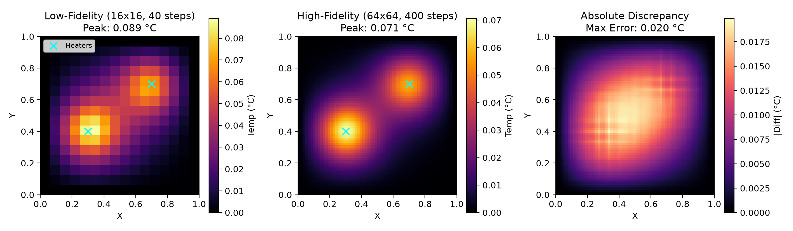
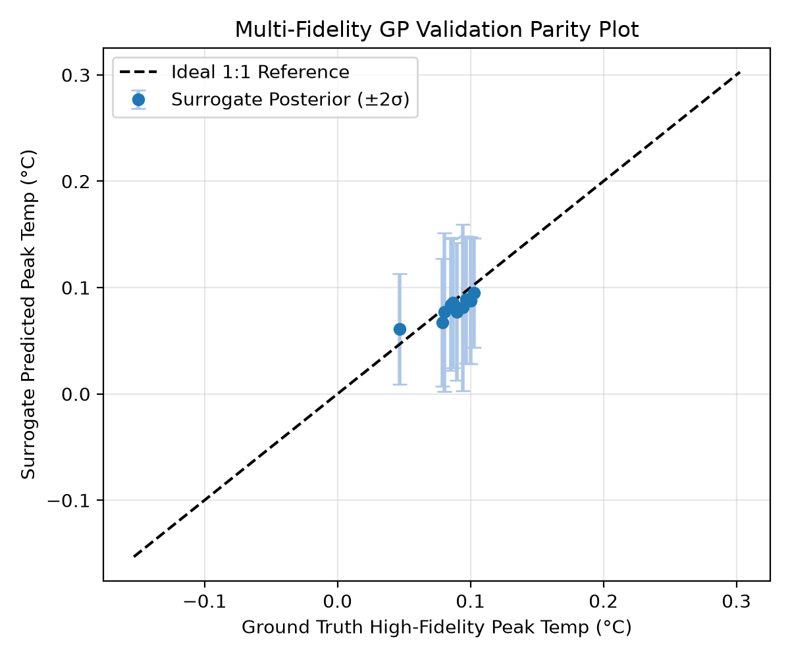
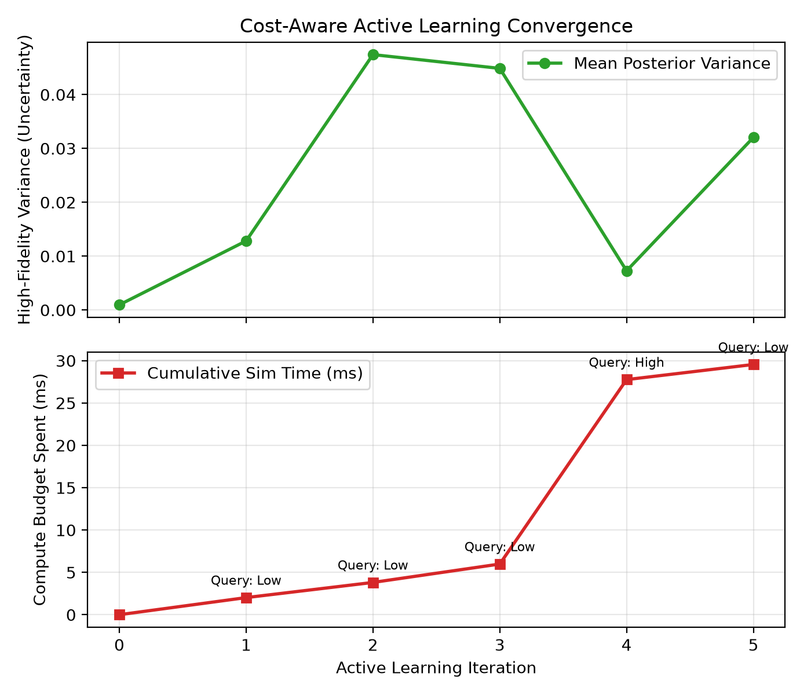

# Multi-Fidelity Gaussian Process Surrogate for Thermal PDE Systems

Surrogate modeling and cost-aware active learning for 2D steady-state heat diffusion simulations using **GPyTorch** and **PyTorch**.

This repository explores multi-task Gaussian Processes to accelerate physical simulations by combining abundant low-fidelity (coarse grid) data with sparse high-fidelity (fine grid) evaluations under a computational budget.

---

## 1. Problem Formulation

We model steady-state heat conduction across a 2D plate $(x, y) \in [0, 1]^2$ governed by the Poisson equation:

$$\nabla^2 T(x, y) = -Q(x, y)$$

subject to homogeneous Dirichlet boundary conditions:

$$T(x, 0) = T(x, 1) = T(0, y) = T(1, y) = 0$$

Thermal loads are modeled as localized Gaussian heat sources:

$$Q(x, y) = \sum_{i=1}^{N} P_i \exp\left(-\frac{(x - s_{x,i})^2 + (y - s_{y,i})^2}{2\sigma^2}\right)$$

where $(s_{x,i}, s_{y,i})$ are spatial positions and $P_i$ are thermal output powers. The PDE is solved using Jacobi relaxation with a 5-point discrete Laplacian stencil.

---

## 2. Multi-Fidelity PDE Benchmark

To simulate real-world engineering trade-offs between simulation speed and physical resolution, two fidelity levels are defined:

- **Low-Fidelity ($m = 0$):** Coarse $16 \times 16$ grid with 40 relaxation steps (~15 ms execution).
- **High-Fidelity ($m = 1$):** Fine $64 \times 64$ grid with 400 relaxation steps (~70 ms execution, ~5× compute cost).



*Figure 1: Spatial temperature field comparison on an identical heater setup showing low-fidelity resolution, high-fidelity ground truth, and the absolute spatial error.*

---

## 3. Multi-Fidelity Gaussian Process Architecture

Each input sample comprises a 7-dimensional vector: 6 physical design parameters $(x_1, y_1, P_1, x_2, y_2, P_2)$ plus 1 discrete fidelity indicator $m \in \{0, 1\}$.

The covariance function is constructed as a separable product (Kronecker structure) between the continuous spatial kernel and a discrete inter-task kernel:

$$K((x, m), (x', m')) = K_{\text{spatial}}(x, x') \cdot K_{\text{task}}(m, m')$$

- **Spatial Kernel:** Matérn-5/2 kernel ($\nu = 2.5$) evaluated across the continuous physical parameters.
- **Task Kernel:** GPyTorch `IndexKernel(num_tasks=2, rank=1)` capturing cross-fidelity correlation.



*Figure 2: Validation parity plot comparing GP surrogate posterior predictions with $95\%$ ($\pm 2\sigma$) confidence intervals against true high-fidelity numerical solutions.*

---

## 4. Cost-Aware Active Learning

Rather than acquiring training data uniformly, the active learning loop queries new simulations by optimizing an uncertainty-to-cost acquisition criterion:

$$\alpha(x, m) = \frac{\sigma_m^2(x)}{c_m}$$

where $\sigma_m^2(x)$ is the posterior predictive variance at fidelity $m$ and $c_m$ is the measured execution runtime.



*Figure 3: Active learning progression showing reduction in mean posterior variance alongside cumulative compute time spent across low-fidelity and high-fidelity acquisitions.*

---

## Quickstart

### Prerequisites

```bash
pip install torch gpytorch matplotlib numpy
```

### Running the Benchmark CLI

Run the full end-to-end benchmark from the terminal with custom initial configurations and active learning steps:

```bash
python run_benchmark.py --n-coarse 8 --n-fine 2 --n-active 5 --save-plots
```

### Running Unit Tests

```bash
python -m unittest discover -s tests -v
```

### Running the Notebook

```bash
jupyter notebook "GP Surrogates.ipynb"
```

---

## Repository Structure

```
multitask-pde-surrogate/
├── pde_surrogate/            # Modular Python package
│   ├── __init__.py           # Package exports
│   ├── solver.py             # Jacobi 2D heat solver & fidelity benchmark
│   ├── model.py              # GPyTorch MultiFidelityGP & training routines
│   └── active_learning.py    # Cost-aware acquisition & query loop
├── tests/
│   └── test_surrogate.py     # Unit test suite
├── run_benchmark.py          # Standalone CLI runner & evaluation
├── GP Surrogates.ipynb       # Main research notebook
├── figures/
│   ├── active_learning_progress.png
│   ├── fidelity_comparison.png
│   └── surrogate_parity.png
├── .gitignore
├── README.md
└── requirements.txt
```
